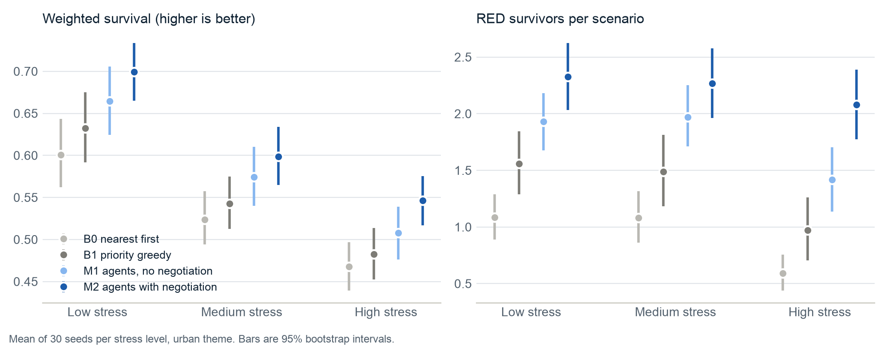

# Results

Generated by `python -m emergency_mas.eval report` from `results/runs.csv`. Do not edit by hand.

Every policy ran on the same scenarios: 5 settings x 30 seeds, 600 runs in total. Differences are paired by seed. Brackets are 95% bootstrap intervals; p-values are Wilcoxon signed-rank tests.

Policies: **B0** nearest first; **B1** priority greedy; **M1** agents, no negotiation; **M2** agents with negotiation.



## Headline

| Stress | Best baseline | M2 minus it: weighted survival | Seeds where M2 is better | p | M2 minus it: expected survivors | Negotiation effect (M2 minus M1) | p |
|---|---|---|---|---|---|---|---|
| low | B1 | +0.067 [+0.045, +0.089] | 80% | 6e-06 | +1.17 [+0.79, +1.55] | +0.034 [+0.020, +0.050] | 0.0002 |
| medium | B1 | +0.056 [+0.038, +0.074] | 87% | 5e-06 | +1.34 [+0.99, +1.69] | +0.025 [+0.013, +0.037] | 0.0005 |
| high | B1 | +0.064 [+0.049, +0.078] | 97% | 1e-08 | +2.00 [+1.62, +2.37] | +0.039 [+0.028, +0.049] | 8e-08 |

## Urban theme, low stress

| Outcome (mean, 95% interval) | B0 | B1 | M1 | M2 |
|---|---|---|---|---|
| Weighted survival | 0.601 (0.562 to 0.643) | 0.632 (0.592 to 0.675) | 0.665 (0.624 to 0.706) | 0.699 (0.665 to 0.734) |
| Expected survivors | 31.9 (30.5 to 33.3) | 32.2 (30.8 to 33.6) | 32.7 (31.2 to 34.3) | 33.4 (31.8 to 34.9) |
| RED survivors | 1.09 (0.89 to 1.29) | 1.56 (1.29 to 1.84) | 1.93 (1.68 to 2.18) | 2.32 (2.03 to 2.62) |
| Victims reaching care | 28.0 (26.4 to 29.7) | 26.8 (25.0 to 28.6) | 30.3 (29.0 to 31.6) | 32.4 (30.9 to 33.8) |
| Critical incidents with a RED patient never treated | 2.00 (1.50 to 2.50) | 1.23 (0.80 to 1.70) | 0.80 (0.50 to 1.13) | 0.80 (0.50 to 1.13) |
| First unit on scene (min) | 43.2 (39.4 to 47.1) | 43.5 (39.0 to 48.2) | 39.7 (35.4 to 44.6) | 32.3 (30.1 to 34.6) |
| Ambulance utilization | 0.97 (0.96 to 0.98) | 0.98 (0.97 to 0.99) | 0.95 (0.93 to 0.96) | 0.94 (0.92 to 0.95) |
| ER bay utilization | 0.57 (0.55 to 0.59) | 0.57 (0.54 to 0.59) | 0.55 (0.53 to 0.57) | 0.55 (0.54 to 0.57) |
| Ambulance minutes waiting at ER doors | 58 (40 to 77) | 29 (20 to 39) | 26 (18 to 36) | 28 (19 to 38) |

## Urban theme, medium stress

| Outcome (mean, 95% interval) | B0 | B1 | M1 | M2 |
|---|---|---|---|---|
| Weighted survival | 0.524 (0.494 to 0.557) | 0.543 (0.512 to 0.575) | 0.574 (0.540 to 0.610) | 0.599 (0.565 to 0.634) |
| Expected survivors | 41.0 (39.0 to 43.2) | 41.4 (39.2 to 43.7) | 42.0 (39.9 to 44.3) | 42.7 (40.5 to 45.1) |
| RED survivors | 1.08 (0.86 to 1.31) | 1.49 (1.18 to 1.81) | 1.97 (1.71 to 2.25) | 2.27 (1.96 to 2.58) |
| Victims reaching care | 23.3 (21.6 to 25.1) | 22.1 (20.2 to 24.0) | 27.4 (26.0 to 28.7) | 31.2 (29.6 to 32.9) |
| Critical incidents with a RED patient never treated | 4.30 (3.67 to 4.93) | 4.40 (3.77 to 5.03) | 3.27 (2.57 to 4.03) | 2.97 (2.43 to 3.50) |
| First unit on scene (min) | 46.9 (41.9 to 51.9) | 47.4 (42.5 to 52.5) | 45.3 (41.3 to 49.7) | 36.0 (33.8 to 38.2) |
| Ambulance utilization | 0.99 (0.99 to 1.00) | 0.99 (0.99 to 1.00) | 0.98 (0.97 to 0.99) | 0.98 (0.97 to 0.99) |
| ER bay utilization | 0.74 (0.72 to 0.76) | 0.75 (0.73 to 0.77) | 0.68 (0.66 to 0.69) | 0.70 (0.68 to 0.72) |
| Ambulance minutes waiting at ER doors | 163 (140 to 186) | 90 (71 to 110) | 73 (58 to 87) | 70 (56 to 83) |

## Urban theme, high stress

| Outcome (mean, 95% interval) | B0 | B1 | M1 | M2 |
|---|---|---|---|---|
| Weighted survival | 0.468 (0.439 to 0.497) | 0.483 (0.452 to 0.514) | 0.508 (0.476 to 0.539) | 0.546 (0.517 to 0.575) |
| Expected survivors | 49.9 (47.7 to 52.1) | 50.1 (48.0 to 52.3) | 50.9 (48.6 to 53.1) | 52.2 (49.9 to 54.3) |
| RED survivors | 0.59 (0.44 to 0.75) | 0.97 (0.70 to 1.26) | 1.42 (1.14 to 1.70) | 2.08 (1.77 to 2.39) |
| Victims reaching care | 15.4 (13.6 to 17.3) | 16.1 (14.5 to 17.6) | 23.3 (22.1 to 24.7) | 27.0 (25.5 to 28.4) |
| Critical incidents with a RED patient never treated | 6.40 (5.80 to 7.00) | 6.47 (5.83 to 7.10) | 5.73 (4.90 to 6.53) | 4.73 (4.07 to 5.40) |
| First unit on scene (min) | 56.3 (51.8 to 60.3) | 58.1 (53.0 to 63.0) | 55.2 (50.5 to 59.6) | 45.2 (41.9 to 48.3) |
| Ambulance utilization | 1.00 (0.99 to 1.00) | 1.00 (0.99 to 1.00) | 0.98 (0.97 to 0.99) | 0.98 (0.97 to 0.99) |
| ER bay utilization | 0.84 (0.83 to 0.86) | 0.85 (0.84 to 0.86) | 0.76 (0.75 to 0.78) | 0.80 (0.78 to 0.81) |
| Ambulance minutes waiting at ER doors | 239 (214 to 264) | 177 (151 to 204) | 118 (102 to 135) | 107 (88 to 126) |

## Paired differences, weighted survival

| Comparison | Theme | Stress | Difference | Seeds better | p |
|---|---|---|---|---|---|
| M2 - B0 | urban_mci | low | +0.098 [+0.080, +0.116] | 97% | 4e-09 |
| M2 - B0 | urban_mci | medium | +0.075 [+0.055, +0.096] | 90% | 2e-07 |
| M2 - B0 | urban_mci | high | +0.078 [+0.067, +0.090] | 100% | 2e-09 |
| M2 - B0 | earthquake | high | +0.047 [+0.039, +0.057] | 100% | 2e-09 |
| M2 - B0 | highway_pileup | high | +0.097 [+0.081, +0.113] | 100% | 2e-09 |
| M2 - B1 | urban_mci | low | +0.067 [+0.045, +0.089] | 80% | 6e-06 |
| M2 - B1 | urban_mci | medium | +0.056 [+0.038, +0.074] | 87% | 5e-06 |
| M2 - B1 | urban_mci | high | +0.064 [+0.049, +0.078] | 97% | 1e-08 |
| M2 - B1 | earthquake | high | +0.047 [+0.040, +0.054] | 100% | 2e-09 |
| M2 - B1 | highway_pileup | high | +0.074 [+0.058, +0.090] | 93% | 3e-08 |
| M2 - M1 | urban_mci | low | +0.034 [+0.020, +0.050] | 80% | 0.0002 |
| M2 - M1 | urban_mci | medium | +0.025 [+0.013, +0.037] | 70% | 0.0005 |
| M2 - M1 | urban_mci | high | +0.039 [+0.028, +0.049] | 93% | 8e-08 |
| M2 - M1 | earthquake | high | +0.023 [+0.017, +0.030] | 90% | 1e-07 |
| M2 - M1 | highway_pileup | high | +0.044 [+0.029, +0.059] | 80% | 5e-05 |
| M1 - B1 | urban_mci | low | +0.032 [+0.013, +0.053] | 63% | 0.007 |
| M1 - B1 | urban_mci | medium | +0.031 [+0.015, +0.048] | 67% | 0.002 |
| M1 - B1 | urban_mci | high | +0.025 [+0.015, +0.036] | 87% | 2e-05 |
| M1 - B1 | earthquake | high | +0.024 [+0.017, +0.030] | 90% | 5e-06 |
| M1 - B1 | highway_pileup | high | +0.030 [+0.017, +0.043] | 80% | 0.0002 |

## Other themes

| Weighted survival | B0 | B1 | M1 | M2 |
|---|---|---|---|---|
| earthquake / high | 0.383 (0.363 to 0.403) | 0.384 (0.364 to 0.404) | 0.407 (0.387 to 0.428) | 0.430 (0.408 to 0.454) |
| highway_pileup / high | 0.487 (0.448 to 0.530) | 0.510 (0.469 to 0.554) | 0.540 (0.494 to 0.588) | 0.584 (0.539 to 0.631) |

## Incident Assessment Agent against the raw caller report

First estimate of each incident, before any unit is on scene. Mean over all M2 runs.

|  | Caller report | Assessment agent |
|---|---|---|
| Victim count bias | -0.418 | 0.010 |
| Victim count RMSE | 0.793 | 0.702 |
| RED count bias | -0.115 | 0.035 |
| RED count RMSE | 0.479 | 0.474 |
| Rank correlation with oracle urgency | 0.806 | 0.805 |

## Communication and negotiation (M2, per run)

| Stress | Messages | Unit conflicts | Hospital counter-offers | Staff requests | Staff moved (pool and loans) | Diversions from full ER doors | Surge openings |
|---|---|---|---|---|---|---|---|
| low | 205.3 | 26.0 | 8.6 | 14.1 | 9.0 | 0.1 | 1.8 |
| medium | 239.8 | 26.3 | 16.4 | 18.2 | 9.2 | 0.0 | 2.4 |
| high | 251.6 | 26.3 | 17.9 | 12.9 | 9.3 | 0.3 | 2.5 |

## Reproduce

```bash
.venv/bin/python -m emergency_mas.eval run --seeds 30
.venv/bin/python -m emergency_mas.eval report
```

The simulator and all four policies are deterministic, so the same command gives the same table.

## Limits

- The world is synthetic and its parameters are illustrative (see ASSUMPTIONS.md). The comparison between policies is the result, not the absolute survival numbers.
- These runs use the rules backend of the agents. The OpenAI Agents SDK agents (M3) are compared with M2 and B0 on 30 seeds in LLM_RESULTS.md.
- Victims still waiting when the 4-hour horizon ends are scored as if care started at the horizon, for every policy.
